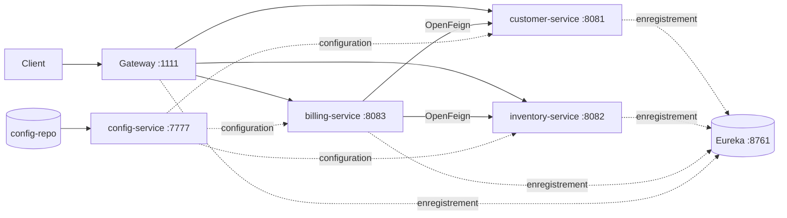

# EcomMicroservices

Activité 2 — Architecture microservices avec Spring Cloud
Réalisé par **Lafnoune Ayman**

## Présentation

Ce projet est une petite application e-commerce découpée en plusieurs microservices indépendants. Chaque service a sa propre base de données H2 et son propre port. Les services se trouvent les uns les autres grâce à Eureka, lisent leur configuration depuis un serveur central, et sont accessibles depuis l'extérieur par une seule porte d'entrée : la gateway.

## Les services

| Service | Port | Rôle |
|---|---|---|
| `config-service` | 7777 | Serveur Spring Cloud Config. Lit les fichiers du dossier `config-repo` (profils par défaut, `dev` et `prod`). |
| `discovery-service` | 8761 | Serveur Eureka : annuaire où chaque service s'enregistre au démarrage. |
| `gateway-service` | 1111 | Spring Cloud Gateway. Route automatiquement les requêtes vers les services trouvés dans Eureka. |
| `customer-service` | 8081 | Gestion des clients (Spring Data REST, H2 `customers-db`). |
| `inventory-service` | 8082 | Gestion des produits (Spring Data REST sous `/api`, H2 `products-db`). |
| `billing-service` | 8083 | Gestion des factures. Récupère le client et les produits d'une facture via OpenFeign. |

## Fonctionnement

**Configuration centralisée.** `customer-service`, `inventory-service` et `billing-service` importent leur configuration depuis `http://localhost:7777`. Les paramètres communs (Eureka, console H2, actuator) sont dans `config-repo/application.properties`, et chaque service a ses fichiers propres (`customer-service.properties`, `customer-service-dev.properties`, …).
Le contrôleur `ConfigTestRestController` de `customer-service` permet de vérifier les valeurs reçues :
- `/testConfig1` affiche les paramètres globaux `p1` et `p2` ;
- `/testConfig2` affiche les paramètres propres au service (`x` et `y`).

**Découverte de services.** La gateway utilise le *discovery locator* : toute requête `/<nom-du-service>/...` est envoyée au service du même nom enregistré dans Eureka.

**Communication entre services.** `billing-service` utilise deux clients OpenFeign (`CustomerServiceRestClient`, `InventoryServiceRestClient`). L'endpoint `/api/bills/{id}` renvoie une facture complète avec le client et le détail des produits.

**Tolérance aux pannes.** Les appels Feign sont protégés par un Circuit Breaker Resilience4j. Si `customer-service` ne répond pas, une méthode de secours renvoie un client par défaut au lieu de faire échouer la facture.

## Lancement

Chaque service est un projet Maven séparé. Il faut les démarrer dans cet ordre et les laisser tous tourner :

1. `config-service`
2. `discovery-service`
3. `customer-service`
4. `inventory-service`
5. `billing-service`
6. `gateway-service`

Le chemin du dossier `config-repo` est défini dans `config-service/src/main/resources/application.properties` (`spring.cloud.config.server.native.search-locations`) et doit être adapté si le projet est déplacé.

## URL utiles

| Description | URL |
|---|---|
| Tableau de bord Eureka | http://localhost:8761 |
| Configuration de customer-service | http://localhost:7777/customer-service/default |
| Clients (via la gateway) | http://localhost:1111/customer-service/customers |
| Produits (via la gateway) | http://localhost:1111/inventory-service/api/products |
| Facture complète n°1 (via la gateway) | http://localhost:1111/billing-service/api/bills/1 |
| Test de configuration | http://localhost:8081/testConfig1 |
| Console H2 des clients | http://localhost:8081/h2-console (`jdbc:h2:mem:customers-db`) |

## Captures des tests

Les captures sont dans le dossier [`screens/`](./screens).

## Technologies

Java 21 · Spring Boot · Spring Cloud (Config, Netflix Eureka, Gateway, OpenFeign, Circuit Breaker / Resilience4j) · Spring Data JPA · Spring Data REST · H2 · Lombok · Maven
